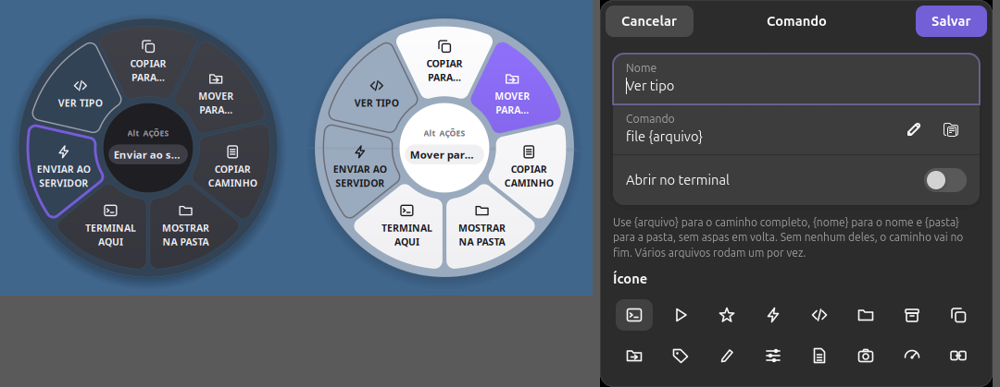
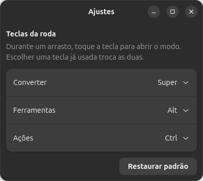
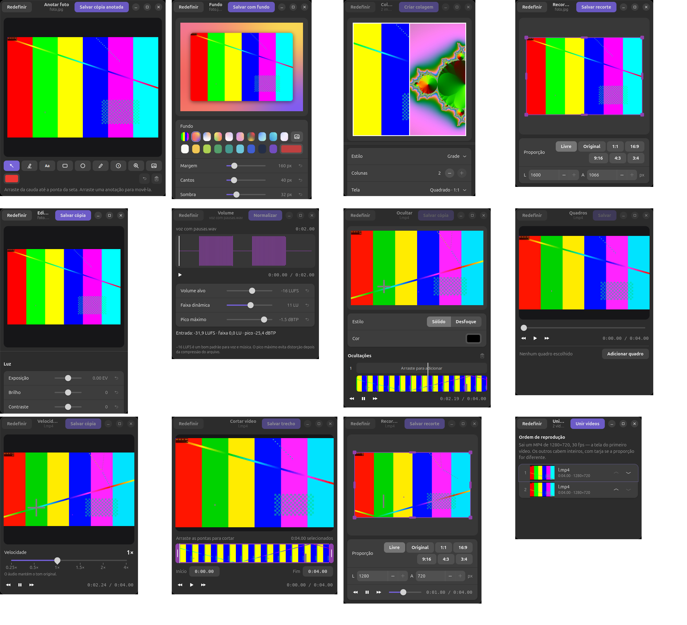

# Bergamota

Conversor e caixa de ferramentas de arquivos para Ubuntu, **sem cliques**: arraste um arquivo, toque uma tecla e solte numa opção da roda. Tudo roda no seu computador; nenhum arquivo sai dele.

Inspirado no [Tangerine](https://tangerineformac.com), para macOS. Bergamota é um projeto independente, sem relação com ele.



## Como funciona

1. Comece a arrastar um arquivo, no Nautilus ou em qualquer app.
2. Com o arquivo ainda preso ao mouse, toque e solte uma tecla:

| Tecla | Roda | O que tem |
|---|---|---|
| Shift | Converter | Formatos de saída |
| Ctrl | Ferramentas | Editar, cortar, comprimir… |
| Alt | Ações | Copiar, mover, terminal e seus comandos |

3. Solte o arquivo na opção.

Com a roda aberta:
- outra tecla troca de roda;
- a mesma tecla fecha;
- Esc cancela o arrasto;
- soltar no miolo cancela.

Um toque só conta se for rápido (menos de 0,6 s), sozinho e feito depois de o arrasto começar. Assim, atalhos como Alt+Tab e Ctrl+clique não abrem a roda.

Sem arrastar, solte o arquivo na janela do app, ou use **Abrir com → Bergamota**, para ver as mesmas opções num menu.

**O original nunca é alterado.** Tudo gera uma cópia ao lado dele, e nomes repetidos viram `nome (1)`.

## Instalação

Precisa de Ubuntu com GNOME no Wayland. Foi testado no **Ubuntu 26.04 (GNOME 50)**. A extensão declara GNOME 45 a 50, mas a ferramenta Recortar usa libadwaita 1.7 ou mais nova, e versões antigas não foram testadas.

```bash
git clone <url-do-repositorio> bergamota
cd bergamota
./install.sh
```

O script único instala as dependências (pede a senha do sudo), copia o app, liga a extensão e roda os testes. No fim, **saia e entre de novo na sessão**: o GNOME só carrega a extensão num novo login.

| Opção | Efeito |
|---|---|
| `--sem-libreoffice` | Não instala o LibreOffice (cerca de 1 GB). Conversões de documento, planilha e slide e PDF para DOCX ficam indisponíveis |
| `--sem-dependencias` | Só copia os arquivos. Use para atualizar |

Depois de atualizar, saia e entre na sessão apenas se a pasta `bergamota@local/` tiver mudado.

### Dependências

```
python3-gi python3-gi-cairo python3-pil python3-numpy gir1.2-gtk-4.0 gir1.2-adw-1
gir1.2-gdkpixbuf-2.0 gir1.2-gstreamer-1.0 gstreamer1.0-plugins-base
gstreamer1.0-plugins-good gstreamer1.0-libav ffmpeg poppler-utils ghostscript
libimage-exiftool-perl libnotify-bin libglib2.0-bin desktop-file-utils
gtk-update-icon-cache libreoffice
```

Opcionais, para formatos de imagem: `heif-gdk-pixbuf` (HEIC), `librsvg2-common` (SVG) e `glycin-loaders` (gravar AVIF).

### Desinstalar

```bash
gnome-extensions disable bergamota@local
```

```bash
rm -rf ~/.local/bin/bergamota ~/.local/share/gnome-shell/extensions/bergamota@local ~/.local/share/applications/io.github.bergamota.desktop ~/.local/share/dbus-1/services/io.github.bergamota.service ~/.local/share/icons/hicolor/512x512/apps/io.github.bergamota.png ~/.config/bergamota
```

## Configurações

Abra os **Ajustes** por qualquer um destes caminhos:
- botão ⚙ da janela do app;
- botão direito no ícone do app;
- botão de configurações no gerenciador de extensões do GNOME.



### Teclas da roda

Cada roda usa Shift, Ctrl, Alt ou Super. Escolher uma tecla já usada troca as duas. Vale no próximo arrasto. Super pode falhar, porque abre a Visão Geral do GNOME.

Fica salvo em `~/.config/bergamota/keys.json`.

### Comandos personalizados

Aparecem na roda de Ações com contorno, em vez de cor. Cada comando tem nome, um de 16 ícones, a linha de comando e a opção de abrir no terminal.

| Parâmetro | Vira |
|---|---|
| `{arquivo}` | Caminho completo |
| `{nome}` | Nome do arquivo |
| `{pasta}` | Pasta do arquivo |

```
gimp {arquivo}
scp {arquivo} servidor:/tmp
```

- Sem parâmetro, o comando roda como foi escrito.
- Não ponha aspas em volta dos parâmetros: o app já protege o valor, e um nome de arquivo nunca vira comando.
- Vários arquivos rodam um por vez.
- O comando roda na pasta do arquivo.
- Fora do terminal, ele roda em segundo plano e só avisa se falhar.

Os comandos rodam com as suas permissões: cadastre só o que confia.

Fica salvo em `~/.config/bergamota/commands.json`.

## Ferramentas



| Tipo | Ferramentas |
|---|---|
| Qualquer arquivo | Comprimir, Metadados, Compactar ZIP |
| Imagem | Editar, Anotar, Fundo, Recortar, Reduzir 50%, Colagem (2+ imagens) |
| Vídeo | Cortar, Recortar, Velocidade, Quadros, Ocultar, Unir vídeos (2+ vídeos) |
| Áudio | Cortar, Normalizar volume, Canais, Bipe, Visualizador |
| PDF | Organizar, Dividir, Unir PDFs (2+ PDFs) |
| Compactados | Extrair |

**Comprimir:** predefinição Equilibrado ou Forte, tamanho das imagens, e alvo em MB ou porcentagem.

**Metadados:** procura, edita e remove campos, e tem "Remover tudo". Em PDF, o arquivo é regravado para não guardar o histórico que o exiftool deixaria. Formatos sem suporte de escrita ficam só para leitura.

**Bipe e Ocultar:** apagam o conteúdo original no trecho. Isso vale para a cópia salva: o arquivo original continua na pasta.

## Conversões

| Entrada | Saída |
|---|---|
| PNG, JPG, WebP, AVIF, TIFF, BMP, GIF, ICO, HEIC, SVG | PNG, JPG, WebP, AVIF, TIFF, BMP, GIF, PDF |
| MP3, M4A, WAV, FLAC, OGG, Opus, AIFF, WMA | Os mesmos |
| MP4, MOV, MKV, WebM, AVI, WMV | Os mesmos, GIF e MP3 |
| PDF | PNG, JPG, TXT, DOCX |
| DOCX, DOC, ODT, RTF, TXT, HTML | PDF, DOCX, ODT, TXT, HTML |
| XLSX, XLS, ODS, CSV | PDF, XLSX, ODS, CSV |
| PPTX, PPT, ODP | PDF, PPTX, ODP, PNG e JPG por slide |
| SRT, VTT | SRT, VTT, TXT |

HEIC e SVG entram, mas não saem: não há codificador disponível.

## Limitações conhecidas

- A roda só detecta teclas modificadoras.
- Mudanças na extensão exigem novo login.
- O fundo desfocado da roda é uma captura feita ao abrir: não acompanha o que se mexe atrás.
- Editar, Anotar, Fundo e Colagem trocam transparência por fundo branco.
- Organizar e Metadados em PDF podem perder marcadores, links e formulários.
- LibreOffice instalado via snap pode não acessar arquivos fora da pasta pessoal.

## Desenvolvimento

```bash
python3 bergamota.py --selftest
```

Imprime `ok` se tudo passar. Arquitetura, convenções e decisões estão em [AGENTS.md](AGENTS.md).
